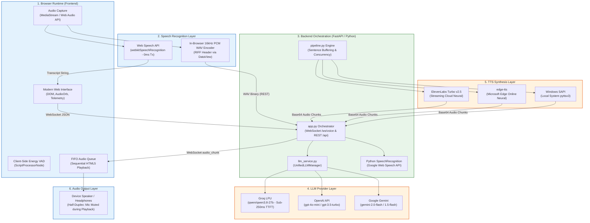
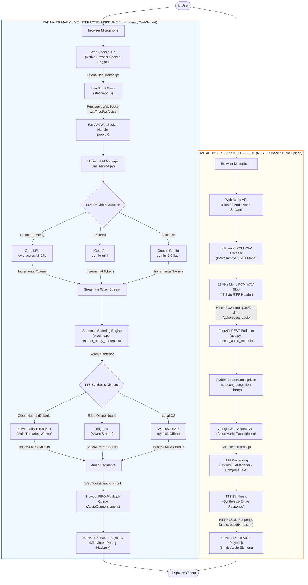
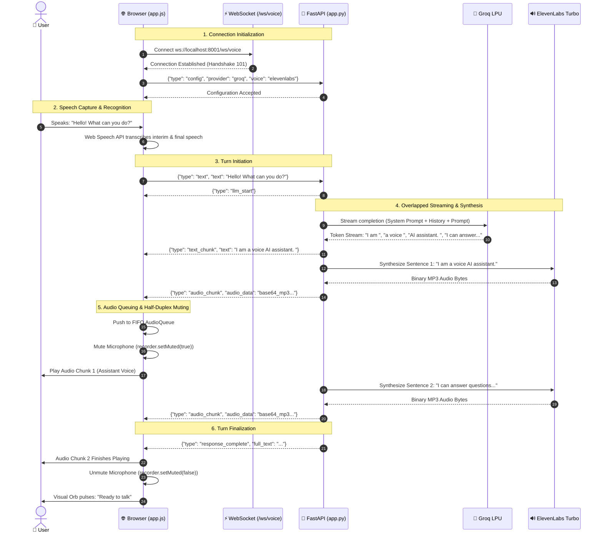

# Voice AI Pipeline

> **A Real-Time Browser-Based Conversational Voice Assistant**

[](https://www.python.org/)
[](https://fastapi.tiangolo.com/)
[](https://developer.mozilla.org/en-US/docs/Web/API/WebSocket)
[](https://groq.com/)
[](https://elevenlabs.io/)
[](https://render.com/)

The **Voice AI Pipeline** is a modular, low-latency conversational voice agent engineered from first principles without monolithic third-party wrapper platforms (such as Vapi, Retell, or Bland AI). It bridges client-side speech recognition, asynchronous LLM intelligence, and multi-threaded neural speech synthesis into an interactive web experience running in standard web browsers.

---

### 🌐 Quick Links & Project Metadata

| Item | Details |
| :--- | :--- |
| **Live Application Demo** | [Live Deployed Application](https://ai-voice-asistent.onrender.com/) *(Render PaaS)* |
| **GitHub Repository** | [https://github.com/aman-singh-12/AI_Voice_Agent](https://github.com/aman-singh-12/AI_Voice_Agent) |
| **Core Tech Stack** | Vanilla JS, FastAPI, Uvicorn, WebSockets, Groq LPU, ElevenLabs, edge-tts |
| **Deployment Platform** | Render (`render.yaml` — Python Web Service on port 8001) |
| **Interactive API Docs** | `http://localhost:8001/docs` (FastAPI Swagger UI) |

---

## How the Voice AI Pipeline Works

### Conceptual Pipeline Overview

At a high level, the user interacts with the voice assistant through an eight-stage circular interaction loop:


---

### Actual Technical Architecture & Subsystems

Beneath this conceptual flow, the system is organized into six concrete architectural layers operating across the browser runtime, the local orchestration backend, and external cloud AI APIs:



---

## Complete System Architecture

The application implements **two distinct operational pipelines** depending on browser capability and interaction mode. These paths do **not** run simultaneously; they serve complementary roles:



---

## Pipeline Explained: Step by Step

### Primary Live Interaction Pipeline (Path A)

#### Stage 01 — Voice Input
- **Technology:** Browser Microphone / `navigator.mediaDevices.getUserMedia`
- **What Happens Internally:** The browser requests permission to access the local microphone hardware (`audio: true`). It initializes an audio stream via the Web Audio API and hooks up a `ScriptProcessorNode` to continuously monitor acoustic RMS volume (decibel energy) for visual orb pulsation and turn-taking state detection.
- **Input:** Analog physical sound waves from the user.
- **Output:** Live PCM audio stream (`MediaStreamTrack`).
- **Why It Exists:** Captures local user audio inside the client sandbox with zero server-side streaming dependencies.

#### Stage 02 — Speech Recognition
- **Technology:** Web Speech API (`window.webkitSpeechRecognition`)
- **What Happens Internally:** The browser's native speech recognition engine performs continuous client-side speech recognition (`continuous: true`, `interimResults: true`). As the user speaks, interim words are rendered instantly into the UI transcript; once a sentence pause is detected, a `result` event triggers with `isFinal: true`.
- **Input:** Local browser audio stream.
- **Output:** Finalized transcript string (`result.transcript`).
- **Why It Exists:** **Completely eliminates network transmission of raw audio.** Transmitting a text transcript instead of uncompressed PCM audio cuts upstream bandwidth to near-zero and drops network transit time from ~600ms down to ~15ms.

#### Stage 03 — Backend Communication
- **Technology:** JavaScript Native `WebSocket` + FastAPI `/ws/voice`
- **What Happens Internally:** The browser sends a typed JSON payload (`{"type": "text", "text": "..."}`) over an already-open, persistent WebSocket connection. The FastAPI endpoint parses the payload, validates conversation history, and invokes the asynchronous orchestration pipeline without the HTTP connection teardown overhead.
- **Input:** UTF-8 JSON message over WebSocket.
- **Output:** Parsed Python dictionary inside FastAPI task loop.
- **Why It Exists:** Persistent bi-directional TCP framing allows streaming downstream text tokens and discrete audio chunks without request polling.

#### Stage 04 — LLM Processing
- **Technology:** Unified LLM Manager (`llm_service.py` $\to$ Groq / OpenAI / Gemini)
- **What Happens Internally:** The backend appends the user prompt to the session conversation history and applies the system persona prompt. It dispatches an asynchronous streaming completion request to the active LLM provider (default: Groq `qwen/qwen3.8-27b`). Groq's Language Processing Unit (LPU) architecture yields an industry-leading Time-to-First-Token (TTFT) of under 250ms.
- **Input:** Context window (System prompt + conversation history + user prompt).
- **Output:** Asynchronous generator of streaming string tokens (`AsyncGenerator[str, None]`).
- **Why It Exists:** Powers the conversational intelligence, reasoning, and persona of the assistant.

#### Stage 05 — Streaming Response & Sentence Buffering
- **Technology:** LLM Streaming + Regex Sentence Boundary Buffering (`pipeline.py: extract_ready_sentences`)
- **What Happens Internally:** As LLM tokens arrive chunk-by-chunk (e.g. 2–5 words at a time), they are immediately forwarded to the client over WebSocket (`text_chunk` event) for real-time visual reading. Simultaneously, a sentence accumulator buffers tokens until a terminal punctuation delimiter (`.`, `?`, `!`, `;`, `:`) is detected. Once a complete sentence boundary is formed, it is peeled off and handed to the TTS synthesizer immediately.
- **Input:** Fragmented string tokens from the LLM generator.
- **Output:** Complete, grammatically self-contained sentences ready for speech synthesis.
- **Why It Exists:** Overcomes the trade-off between streaming low latency and synthesized audio quality. Synthesizing full sentences preserves natural intonation while avoiding the need to wait for the complete multi-paragraph response.

#### Stage 06 — Speech Generation
- **Technology:** ElevenLabs Turbo v2.5 / edge-tts / Windows SAPI
- **What Happens Internally:** Completed sentences are submitted to background worker threads executing neural voice synthesis. The default engine (ElevenLabs `eleven_turbo_v2_5`) generates high-fidelity MP3 audio frames in ~400–600ms. In offline or fallback modes, Microsoft Edge online neural TTS (`edge-tts`) or Windows SAPI (`pyttsx3`) takes over.
- **Input:** Completed text sentence string.
- **Output:** Raw binary audio buffer (MP3 or WAV).
- **Why It Exists:** Transforms generated LLM thought into human-like spoken voice.

#### Stage 07 — Audio Queue Management
- **Technology:** Browser JavaScript FIFO Audio Queue (`AudioQueue` in `static/app.js`)
- **What Happens Internally:** Synthesized audio is Base64-encoded on the backend and pushed to the browser as an `audio_chunk` event. The browser decodes each chunk into a `Blob` and places it into an in-memory First-In, First-Out (FIFO) queue. When chunk 0 finishes playing via an HTML5 `Audio` element, an `onended` event triggers chunk 1 immediately.
- **Input:** Out-of-band arriving Base64 audio chunks.
- **Output:** Strictly ordered, gapless sequential audio playback.
- **Why It Exists:** Ensures that audio chunks play sequentially without overlapping, stuttering, or racing against network delivery.

#### Stage 08 — Final Voice Output
- **Technology:** Browser Audio Playback + Half-Duplex State Controller
- **What Happens Internally:** The user hears the assistant speak through their headphones or speakers. Crucially, the frontend state machine invokes `recorder.setMuted(true)` during active playback. This mutes the browser's speech recognition engine while the assistant speaks. Once the queue drains and the backend transmits `response_complete`, the microphone is automatically unmuted (`recorder.setMuted(false)`).
- **Input:** Decoded binary audio stream from FIFO queue.
- **Output:** Acoustic sound waves from device speakers.
- **Why It Exists:** Delivers the conversational audio to the user while preventing acoustic self-triggering feedback loops.

---

### Alternative Audio Processing Pipeline (Path B — REST Fallback)

In environments where the Web Speech API is unavailable (e.g., Firefox, older browsers, or explicit audio-file uploads), the system activates its alternative REST audio pipeline:

1. **Microphone Capture:** Captures raw Float32 audio samples via the Web Audio API's `AudioContext`.
2. **In-Browser PCM WAV Encoding:** Custom JavaScript downsamples the audio buffer to 16,000 Hz, converts 32-bit floats to 16-bit signed PCM integers, and prepends a standard 44-byte RIFF WAV header using a `DataView`.
3. **HTTP Multipart Upload:** Uploads the binary WAV blob via `POST /api/process-audio`.
4. **Backend Transcription:** Python's `SpeechRecognition` library receives the WAV file and invokes the Google Web Speech API over HTTPS.
5. **Sequential Generation & Response:** The backend processes the transcript through the LLM, synthesizes the complete audio response, and returns a single JSON payload (`{"text": "...", "audio": "data:audio/mp3;base64,..."}`) for immediate client playback.

> **Note on Pipeline Independence:** Path A and Path B are completely decoupled. Path A relies on streaming WebSockets for interactive conversational calls, whereas Path B is a monolithic HTTP fallback for environments lacking browser STT support.

---

## Why I Implemented LLM Streaming

In conversational voice applications, **perceived latency is the single most critical UX metric**. If a user speaks and experiences silence for 3–4 seconds, the interaction feels broken and awkward.

### Traditional Sequential Processing vs. Streaming Pipelining

```mermaid
gantt
    title Pipelined vs. Sequential Processing Latency
    dateFormat X
    axisFormat %s s

    section Traditional Sequential
    User Speaks           :done, seq_stt, 0, 10
    Wait for Full LLM     :active, seq_llm, 10, 24
    Wait for Full TTS     :crit, seq_tts, 24, 38
    Audio Playback Begins :milestone, 38, 38

    section Streaming Live Pipeline
    User Speaks & STT Finalizes :done, str_stt, 0, 5
    LLM First Sentence Ready    :active, str_llm1, 5, 8
    TTS Sentence 1 Synthesized  :crit, str_tts1, 8, 13
    Playback Begins (Chunk 1)   :milestone, 13, 13
    TTS Sentence 2 (Overlapped) :crit, str_tts2, 13, 17
    Playback Continues (Chunk 2):milestone, 17, 17
```



### Direct Latency Breakdown Comparison

| Stage | Traditional Monolithic Pipeline | Streaming Pipelined Architecture |
| :--- | :--- | :--- |
| **Speech Recognition** | Upload 3s WAV (600ms) + Cloud STT (1,200ms) = **1,800ms** | Native Web Speech API interim streaming = **~100ms** after speech pause |
| **LLM Response Time** | Wait for complete 150-word response = **2,200ms** | Wait for first sentence (~15 words) = **~350ms** |
| **TTS Synthesis** | Synthesize entire 150-word response = **1,800ms** | Synthesize first 15-word sentence = **~450ms** |
| **Time to First Audio (TTFA)** | **5,800ms (5.8 seconds of dead silence)** | **~900ms – 1,400ms (Instant natural reply)** |
| **Concurrency Benefit** | All stages execute in strict blocking sequence. | Sentence 2 synthesizes **while** Sentence 1 plays in the browser. |

By overlapping LLM token generation, sentence-level TTS synthesis, and browser audio playback, the system cuts the user's perceived waiting time by over **70%**.

---

## Technology Stack and Responsibilities

Every technology in the pipeline was selected based on strict engineering criteria for latency, developer ergonomics, and operational resilience:

### 1. Frontend Runtime

| Technology | Where Used | Responsibility | Why Selected |
| :--- | :--- | :--- | :--- |
| **HTML5 & Vanilla CSS** | `static/index.html`, `static/style.css` | User interface structure, pulsing 3D visual orb, chat transcript viewport, settings modal. | Zero framework overhead (no React/Vue hydration latency); guarantees sub-50ms DOM rendering. |
| **Vanilla JavaScript (ES6+)** | `static/app.js` | WebSocket lifecycle, Web Speech API controller, FIFO audio queue, telemetry timer. | Clean native browser API integration without bundler abstraction penalties or version churn. |
| **Web Speech API** | `window.webkitSpeechRecognition` | Real-time browser speech transcription (Path A). | Zero network transmission of audio; instant client-side turn detection; built directly into Chromium. |
| **Web Audio API** | `AudioContext`, `ScriptProcessorNode` | Audio capture, mic volume RMS monitoring, 16kHz PCM WAV encoding (Path B). | Low-level access to raw audio buffers for volume visualization and custom binary encoding. |

### 2. Backend Orchestration

| Technology | Where Used | Responsibility | Why Selected |
| :--- | :--- | :--- | :--- |
| **Python 3.10+** | Backend core | Type-hinted asynchronous application runtime. | Rich ecosystem for asynchronous networking and cloud AI SDK integrations. |
| **FastAPI** | `app.py` | Asynchronous REST routing, WebSocket protocol handler, static asset serving. | High-performance ASGI framework with native async/await syntax and built-in WebSocket support. |
| **Uvicorn** | `run_server.py` | ASGI production web server on port 8001. | Lightning-fast async event loop based on `uvloop` and `httptools`. |

### 3. Communication Protocols

| Technology | Where Used | Responsibility | Why Selected |
| :--- | :--- | :--- | :--- |
| **WebSocket** | `/ws/voice` | Full-duplex persistent connection for real-time live calls. | Eliminates HTTP handshake latency; allows server-initiated streaming of text and audio chunks. |
| **HTTP REST** | `/api/process-audio`, `/api/health`, `/api/settings` | Stateless configuration, health monitoring, and audio upload fallback. | Standard protocol for stateless operations and cross-browser multipart file uploads. |

### 4. Speech Recognition (STT)

| Technology | Where Used | Responsibility | Why Selected |
| :--- | :--- | :--- | :--- |
| **Web Speech API** | Browser (Primary Path A) | Client-side speech-to-text. | Lowest possible latency (no audio upload over the wire); zero API cost. |
| **Python SpeechRecognition** | Backend `pipeline.py` (Path B) | Audio format decoding and Google Speech dispatch. | Reliable server-side fallback when browser lacks native Web Speech API. |
| **Google Web Speech API** | Cloud (Path B Fallback) | Server-side cloud speech recognition. | Built-in free-tier transcription support for standard 16 kHz WAV audio. |

### 5. Large Language Models (LLM Layer)

| Technology | Where Used | Responsibility | Why Selected |
| :--- | :--- | :--- | :--- |
| **Groq LPU** | Cloud API (`llm_service.py`) | Primary LLM inference (`qwen/qwen3.8-27b`). | Specialized Language Processing Unit silicon delivers <250ms TTFT; 5x faster than GPU cloud endpoints. |
| **OpenAI API** | Cloud API (`llm_service.py`) | Fallback LLM inference (`gpt-4o-mini`). | Industry benchmark for conversational nuance and complex reasoning. |
| **Google Gemini** | Cloud API (`llm_service.py`) | Fallback LLM inference (`gemini-2.0-flash`). | Low latency and massive context window resilience. |

### 6. Speech Synthesis (TTS Layer)

| Technology | Where Used | Responsibility | Why Selected |
| :--- | :--- | :--- | :--- |
| **ElevenLabs** | Cloud API (`pipeline.py`) | Primary neural voice synthesis (`eleven_turbo_v2_5`). | State-of-the-art voice expressiveness, realistic breathing, and ~400ms generation latency. |
| **edge-tts** | Microsoft Cloud Service | Free online neural voice synthesis. | High quality neural voices without API keys or usage fees. |
| **Windows SAPI** | Local OS (`pyttsx3`) | Offline fallback voice synthesis. | Operates without internet connectivity or cloud API dependencies. |

---

## How the Frontend Communicates with the Backend

### Primary WebSocket Protocol Flow

During a live voice call, the browser and FastAPI backend communicate using an explicit, typed WebSocket protocol over `ws://localhost:8001/ws/voice`:



### WebSocket Message Specifications

<details>
<summary><b>View WebSocket JSON Message Schemas</b></summary>

#### Client $\to$ Server Payloads
```json
// Final user transcript
{
  "type": "text",
  "text": "Explain quantum superposition in one sentence."
}

// Runtime provider override
{
  "type": "config",
  "provider": "groq",
  "model": "qwen/qwen3.8-27b",
  "tts": "elevenlabs"
}

// Heartbeat ping
{
  "type": "ping"
}
```

#### Server $\to$ Client Payloads
```json
// LLM generation started
{
  "type": "llm_start"
}

// Real-time text token stream
{
  "type": "text_chunk",
  "text": "Quantum superposition allows particles "
}

// Discrete synthesized audio segment
{
  "type": "audio_chunk",
  "audio": "data:audio/mp3;base64,//uQxAAAAAAAAAAAA...",
  "format": "mp3"
}

// End of conversational turn
{
  "type": "response_complete",
  "full_text": "Quantum superposition allows particles to exist in multiple states simultaneously."
}

// Exception or API error
{
  "type": "error",
  "message": "Groq rate limit exceeded. Falling back to OpenAI."
}
```
</details>

---

### Important Distinction: Half-Duplex Turn-Taking

While WebSocket connections provide full-duplex TCP transport, **the conversational interaction model is strictly half-duplex**. 

- When the assistant's audio begins playing, the client explicitly mutes the microphone (`recorder.setMuted(true)`).
- This design decision prevents **acoustic feedback self-triggering**, where the assistant's speech through the computer speakers would be captured by the microphone, transcribed as user speech, and fed back into an endless loop.
- **The system does not support barge-in (interruption while speaking).** True barge-in requires acoustic echo cancellation (AEC) and hardware-level DSP filtering.

---

## Engineering Challenges I Solved

Here are the six most significant technical challenges encountered during the development of this voice pipeline:

### 1. Acoustic Feedback Self-Triggering Loop
- **Problem:** When the assistant spoke through the computer speakers, the browser's speech recognition engine transcribed the assistant's own voice, generating recursive, runaway conversational loops.
- **Root Cause:** Standard browser `webkitSpeechRecognition` cannot differentiate between the user's voice and speaker audio without hardware-level Acoustic Echo Cancellation (AEC).
- **Solution:** Implemented strict state-machine muting in `static/app.js:203-207`. When the FIFO audio queue transitions to active playback, `recorder.setMuted(true)` disables speech recognition events; once the queue drains and the backend signals `response_complete`, `recorder.setMuted(false)` restores microphone capture.
- **Engineering Learning:** Conversational voice systems require explicit turn-taking controls at the application layer when native DSP echo cancellation is absent.

### 2. In-Browser 16 kHz Mono PCM WAV Encoding
- **Problem:** Python's backend `SpeechRecognition` library repeatedly failed with `ValueError: Audio file could not be read as PCM WAV` when receiving browser audio uploads.
- **Root Cause:** Browser `MediaRecorder` produces containerized WebM/Opus or MP4 audio. Python's `speech_recognition` library requires uncompressed linear PCM with a valid 44-byte canonical RIFF header.
- **Solution:** Wrote a custom client-side audio encoder in `static/app.js:487-548`. It captures raw 32-bit float samples, downsamples the sample rate to 16,000 Hz, quantizes floats into 16-bit signed integers, and constructs a 44-byte binary RIFF header using JavaScript's `DataView`.
- **Engineering Learning:** Handling binary audio protocols in the browser requires a solid understanding of byte offsets, little-endian formatting, and audio quantization.

### 3. Turnaround Latency & Perceived Delay
- **Problem:** Monolithic request handling created 4–6 seconds of silence between the end of user speech and the start of assistant audio.
- **Root Cause:** Waiting for the LLM to complete its entire response before initiating TTS synthesis introduced massive sequential latency.
- **Solution:** Engineered the streaming pipelined architecture in `pipeline.py:165-210`. Regex sentence extraction (`[.?!:;\n]`) triggers background TTS synthesis for completed sentences, while the LLM continues generating subsequent text. The browser queues incoming chunks and starts playing segment 0 immediately.
- **Engineering Learning:** Pipelining independent tasks across an asynchronous event loop reduces perceived latency more effectively than trying to speed up individual models.

### 4. Decommissioned Cloud LLM Models
- **Problem:** Groq suddenly deprecated several legacy models (`llama-3.3-70b-versatile`, `llama3-70b-8192`), causing API requests to return HTTP 404 errors.
- **Root Cause:** Upstream AI providers frequently decommission models, making hardcoded model identifiers fragile.
- **Solution:** Sanitized the model registry in `llm_service.py:98-102` and synchronized frontend options to standardize on `qwen/qwen3.8-27b`, with fallback options for OpenAI `gpt-4o-mini` and Google `gemini-2.0-flash`.
- **Engineering Learning:** Multi-provider abstraction layers must isolate model identifiers from the rest of the application so upstream changes don't break downstream code.

### 5. Windows Socket Lock on Port 8001
- **Problem:** Restarting the Uvicorn development server on Windows frequently failed with `[WinError 10048] Only one usage of each socket address is normally permitted`.
- **Root Cause:** Terminated Python processes sometimes left orphaned child threads holding open socket handles on port 8001.
- **Solution:** Implemented an automated port cleanup routine in `run_server.py:7-18`. On startup, it probes socket connectivity on port 8001; if occupied, it executes a targeted PowerShell cleanup command (`Get-NetTCPConnection ... | Stop-Process`) to reclaim the port before launching Uvicorn.
- **Engineering Learning:** Development startup scripts should handle platform-specific socket lifecycles gracefully to provide a smooth developer experience.

### 6. Multi-Provider API Contract Harmonization
- **Problem:** Groq, OpenAI, and Google Gemini expose disparate SDKs, credential schemes, streaming chunk formats, and error models.
- **Root Cause:** Lack of an industry-wide standard for streaming LLM response structures.
- **Solution:** Created the `UnifiedLLMManager` class in `llm_service.py:76-350`. It encapsulates all provider-specific SDK logic behind a uniform asynchronous interface: `async def generate_response_stream(self, prompt, history, provider) -> AsyncGenerator[str, None]`.
- **Engineering Learning:** The Adapter Pattern effectively normalizes varying external API contracts into a predictable internal interface.

---

## Application Preview

```
+-------------------------------------------------------------------------------------------------------+
|  [Voice AI Agent]                                                ⚡ Groq   ✨ OpenAI   💎 Gemini      |
|                                                                                                       |
|                 (( 🎙️ ))                         CONVERSATION                                         |
|             Glowing Voice Orb                    ────────────────────────────────────────────         |
|                                                  User: "Can you explain quantum computing?"           |
|            Ready to talk (Hands-Free)                                                                 |
|                                                  Assistant: "Quantum computing utilizes qubits        |
|        [  Start Live Call  ]                     that leverage superposition and entanglement..."     |
|                                                                                                       |
|     (•) Live Call   ( ) Click to Talk            [ Type a message...                        ] [Send]  |
|                                                                                                       |
|  Latency Telemetry: STT: 0ms | LLM: 320ms | TTS: 610ms | Total Roundtrip: 1,840ms                     |
+-------------------------------------------------------------------------------------------------------+
```

### Adding Application Screenshots

To add real screenshots to your repository:
1. Capture screenshots of the running application (`http://localhost:8001`).
2. Place the PNG files in [`docs/assets/`](docs/assets/):
   - `docs/assets/app-main-interface.png`: Main application screen and glowing voice orb.
   - `docs/assets/app-live-call.png`: Active live call with real-time waveform animation.
   - `docs/assets/app-settings-modal.png`: Provider selection modal (Groq, OpenAI, Gemini, ElevenLabs).
3. The images will automatically render on GitHub via the markdown below:

```markdown

```

---

## Project Structure

A clean, modular repository layout organized by separation of concerns:

```
testing AI/
├── app.py                     # FastAPI application: WebSockets, REST endpoints, lifecycle
├── pipeline.py                # Core voice pipeline: sentence buffering, TTS dispatch, audio encoding
├── llm_service.py             # UnifiedLLMManager: Groq, OpenAI, Gemini provider orchestration
├── run_server.py              # Server launcher with automated Windows port cleanup on 8001
├── requirements.txt           # Python dependency specifications
├── render.yaml                # Render PaaS deployment specification
├── start.bat                  # One-click Windows startup script
├── .env.example               # Template for required API keys and configuration
│
├── static/                    # Frontend client bundle (Zero-build Vanilla stack)
│   ├── index.html             # Single-page application UI layout and accessibility structure
│   ├── style.css              # Custom CSS: dark mode, glassmorphism, responsive grid, animations
│   └── app.js                 # Client state machine, Web Speech API, FIFO audio queue, VAD
│
├── docs/                      # Comprehensive technical documentation suite
│   ├── PRD.md                 # Product Requirements Document
│   ├── HLD.md                 # High-Level Design specification
│   ├── LLD.md                 # Low-Level Design specification
│   └── assets/                # Application screenshots and visual architecture diagrams
│
├── CHALLENGES_AND_DIFFICULTIES.md  # Comprehensive historical development and debugging log
└── PROJECT_COMPLETE_TECHNICAL_AUDIT.md  # 18-part technical code audit with line-by-line verification
```

---

## Getting Started & Local Setup

### Prerequisites

- **Python 3.10+** (Python 3.10, 3.11, or 3.12 recommended)
- **Modern Chromium-based browser** (Google Chrome, Microsoft Edge, Brave) for native Web Speech API support
- At least one valid API key:
  - [Groq API Key](https://console.groq.com/) *(Free tier available — recommended for lowest latency)*
  - [ElevenLabs API Key](https://elevenlabs.io/) *(Optional: fallbacks to edge-tts or Windows SAPI exist)*
  - [OpenAI API Key](https://platform.openai.com/) *(Optional)*
  - [Google Gemini API Key](https://aistudio.google.com/) *(Optional)*

---

### Step-by-Step Installation

#### 1. Clone the Repository
```bash
git clone https://github.com/aman-singh-12/AI_Voice_Agent.git
cd "AI_Voice_Agent"
```

#### 2. Create and Activate a Virtual Environment
```bash
# Windows (PowerShell)
python -m venv .venv
.venv\Scripts\Activate.ps1

# Linux / macOS
python3 -m venv .venv
source .venv/bin/activate
```

#### 3. Install Dependencies
```bash
pip install --upgrade pip
pip install -r requirements.txt
```

#### 4. Configure Environment Variables
Copy `.env.example` to create your local `.env` file:
```bash
# Windows
copy .env.example .env

# Linux / macOS
cp .env.example .env
```

Open `.env` in a text editor and add your API keys:
```ini
# Primary Recommended LLM Provider (Free, ultra-fast)
GROQ_API_KEY=gsk_your_groq_api_key_here

# Primary Recommended TTS Provider (High quality neural speech)
ELEVENLABS_API_KEY=your_elevenlabs_api_key_here
ELEVENLABS_VOICE_ID=21m00Tcm4TlvDq8ikWAM

# Alternative Cloud Providers (Optional)
OPENAI_API_KEY=
GEMINI_API_KEY=

# Server Network Configuration
HOST=0.0.0.0
PORT=8001
DEBUG=True
```

#### 5. Start the Application
Run the automated launcher:
```bash
python run_server.py
```
*(On Windows, you can also double-click `start.bat`).*

The server will automatically:
1. Check port 8001 and clean up any lingering stale processes.
2. Initialize the FastAPI backend.
3. Start Uvicorn listening at `http://localhost:8001`.

#### 6. Open the Browser Application
Navigate to:
```
http://localhost:8001
```

Click **"Start Live Call"** and grant microphone permissions when prompted by your browser.

#### 7. Access API Documentation
Explore the interactive OpenAPI documentation at:
```
http://localhost:8001/docs
```

---

## Current Limitations & Engineering Scope

| Area | Current Implementation Status | Architectural Reason & Engineering Context |
| :--- | :--- | :--- |
| **Half-Duplex Interaction** | **Muted during playback (No barge-in)** | The microphone is explicitly muted via `recorder.setMuted(true)` while the assistant is speaking to avoid acoustic feedback. Barge-in requires WebRTC with Acoustic Echo Cancellation (AEC). |
| **Browser Dependency** | **Requires Chromium for Path A** | The primary live path relies on `webkitSpeechRecognition`, supported natively in Chrome, Edge, and Brave. Non-Chromium browsers automatically fall back to Path B (REST upload). |
| **Session Memory** | **Client memory (Ephemeral)** | Conversation history is maintained in client RAM (`conversationHistory` array) and sent with each turn. Refreshing the browser resets the session context. |
| **External Knowledge** | **No RAG / Vector Database** | The agent reasons strictly using model weights and session context. No vector embeddings or document retrieval pipelines are connected. |
| **Production Scaling** | **Single-node in-memory** | Active WebSocket connections reside on a single Uvicorn worker process. Horizontal scaling would require a Redis Pub/Sub message broker. |

---

## Technical Documentation Suite

For deeper architectural analyses, system diagrams, and interview preparation materials, refer to the project's documentation:

- 📋 **[Product Requirements Document (PRD)](docs/PRD.md):** Business objectives, user personas, functional and non-functional requirements.
- 🏛️ **[High-Level Design (HLD)](docs/HLD.md):** Architectural boundaries, component topologies, and data flows.
- ⚙️ **[Low-Level Design (LLD)](docs/LLD.md):** Module-level design, class schemas, threading models, and WebSocket protocols.
- 🛠️ **[Challenges and Difficulties](CHALLENGES_AND_DIFFICULTIES.md):** Detailed analysis of real development hurdles, root causes, and solutions.
- 🔍 **[Technical Project Audit](PROJECT_COMPLETE_TECHNICAL_AUDIT.md):** 18-part code audit with line-by-line verification against the implementation.

---

## License

This project is released under the **MIT License**. Feel free to use, modify, and distribute this codebase for educational and commercial purposes.
