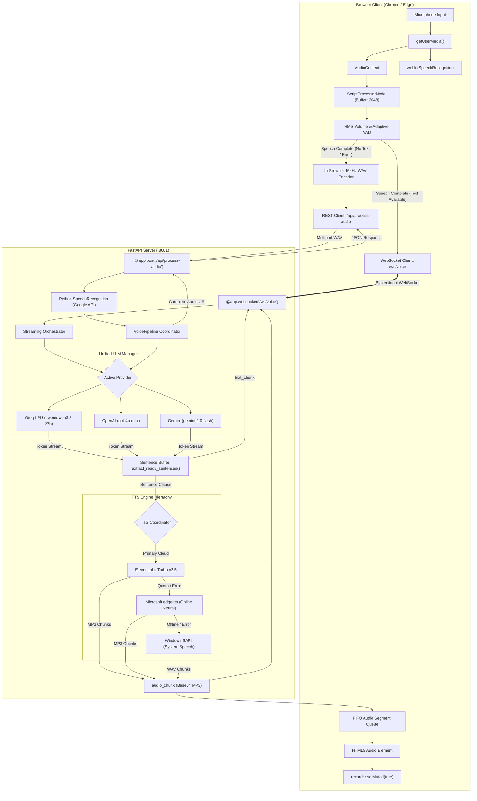

# High-Level Design (HLD)

**Project Name:** Voice AI Agent Pipeline  
**Version:** 1.1.0  
**Target Read Time:** 5–7 Minutes  
**Document Owner:** Engineering Architecture  
**Last Updated:** October 2026  

---

## 1. Architecture Overview

The **Voice AI Agent Pipeline** is an asynchronous, event-driven voice processing architecture operating across a modern web browser client and a lightweight FastAPI server. The design decouples real-time audio acquisition, speech transcription, language model reasoning, and neural speech synthesis into modular, pipelined stages to minimize turnaround latency.

```
+-------------------------------------------------------------------------------------------------------+
|                                      HIGH-LEVEL SYSTEM OVERVIEW                                       |
|                                                                                                       |
|  [ BROWSER CLIENT: HTML5 / Vanilla JS / Web Audio ]                                                   |
|    |-- Audio Capture & VAD : getUserMedia -> ScriptProcessorNode -> RMS Energy Tracking               |
|    |-- Primary Speech STT   : webkitSpeechRecognition (continuous streaming in-browser STT)          |
|    |-- Fallback Audio Enc   : 16kHz Mono 16-bit PCM WAV (custom in-browser DataView encoder)          |
|    |-- Playback Engine      : Sequential FIFO Audio Queue -> HTML5 Audio Element                      |
|                                                                                                       |
|        │ WebSocket: /ws/voice (Bidirectional JSON)        │ REST: /api/process-audio (Fallback)       |
|        ▼                                                  ▼                                           |
|                                                                                                       |
|  [ BACKEND SERVER: FastAPI / Uvicorn (Port 8001) ]                                                    |
|    |-- Route Orchestration : WebSocket Streaming Hub & REST Controller                               |
|    |-- Fallback STT Engine : Python SpeechRecognition -> Google Web Speech API                        |
|    |-- Unified LLM Manager : Abstract Provider Layer (Groq / OpenAI / Gemini / Ollama)                |
|    |-- Streaming Pipeline  : Token Generator -> Sentence Boundary Buffer (extract_ready_sentences)   |
|    |-- TTS Synthesis Layer : Pipelined ElevenLabs Turbo v2.5 -> edge-tts -> Windows SAPI              |
+-------------------------------------------------------------------------------------------------------+
```

---

## 2. Technology Stack

The following technologies are verified in the active codebase:

| Layer | Technology | Actual Code Usage | Architectural Justification |
| :--- | :--- | :--- | :--- |
| **Frontend Framework** | **Vanilla JavaScript (ES6+)** | `static/app.js`, `static/audio-recorder.js` | Direct control over mutable Web Audio API nodes without virtual DOM re-render tear-downs or bundler overhead. |
| **Styling & UI** | **Vanilla CSS3** | `static/style.css`, `static/index.html` | Custom design system with glassmorphism, responsive flex layouts, and zero external CSS runtime dependencies. |
| **Audio Acquisition** | **Web Audio API** | `AudioContext`, `ScriptProcessorNode` | Direct access to raw Float32 PCM audio buffers; enables custom in-browser VAD and 16kHz decimation. |
| **Primary STT** | **Web Speech API** | `webkitSpeechRecognition` | Native browser speech recognition yielding continuous interim/final transcripts with near-zero (<50ms) perceived delay. |
| **Fallback STT** | **Python `SpeechRecognition`** | `pipeline.py:33-79` (`recognize_google`) | Robust server-side fallback for browsers without Web Speech API or when client recognition drops speech. |
| **Backend Runtime** | **Python 3.10+ / FastAPI** | `app.py` | High-performance asynchronous ASGI framework with native async WebSocket and multi-threaded endpoint support. |
| **ASGI Web Server** | **Uvicorn (standard)** | `run_server.py`, `app.py` | Production-grade ASGI server handling asynchronous event loops and WebSocket connections. |
| **Real-Time Transport**| **WebSockets (`/ws/voice`)** | Native WebSocket client & FastAPI route | Bidirectional, low-overhead framing allowing simultaneous token delivery and interleaved audio segments. |
| **REST Transport** | **HTTP REST (`/api/*`)** | FastAPI JSON routes | Stateless management endpoints (`/api/status`, `/api/save-keys`, `/api/llm/test`) and audio blob fallback. |
| **Primary LLM** | **Groq LPU (`qwen/qwen3.8-27b`)** | `llm_service.py:88-241` | Industry-leading Time-to-First-Token (<300ms) on dedicated LPU hardware for voice conversations. |
| **Secondary LLMs** | **OpenAI & Google Gemini** | `gpt-4o-mini`, `gemini-2.0-flash` | Standardized cloud LLM alternatives selectable via the Unified LLM Manager. |
| **Local LLM Fallback**| **Local Ollama** | `qwen2.5:1.5b` via `http://127.0.0.1:11434` | Offline development and CPU fallback support. |
| **Primary TTS** | **ElevenLabs Turbo v2.5** | REST API (`eleven_turbo_v2_5`) | High-fidelity neural voice synthesis with sub-400ms per-sentence synthesis latency. |
| **Fallback TTS 1** | **Microsoft `edge-tts`** | Python `edge-tts` package | Free online neural voice stream (`en-US-JennyNeural`) requiring zero API key configuration. |
| **Fallback TTS 2** | **Windows System.Speech SAPI** | PowerShell .NET invocation | Guaranteed offline, zero-network emergency local speech synthesis fallback. |

---

## 3. Complete System Architecture Diagram

The system provides two distinct processing paths: **Path A (Primary Live Interaction)** and **Path B (Alternative Audio Processing Fallback)**.



---

## 4. Architecture Explanation

### 4.1 Browser Frontend Layer
The frontend manages the hardware interface, user interaction states, and DOM presentation. It runs an adaptive energy-based Voice Activity Detection (VAD) algorithm on the audio thread while concurrently receiving interim speech recognition events from the browser's native engine. It maintains a state machine (`sessionState`) governing the central visualizer orb and primary action controls.

### 4.2 Transport Layer
- **WebSocket (`/ws/voice`):** Serves as the primary real-time pipeline. Transmits user transcripts and carries interleaved token text chunks and base64 MP3 audio segments back to the browser.
- **REST APIs (`/api/*`):** Handles operational management (`/api/status`, `/api/save-keys`, `/api/llm/test`) and serves as the non-streaming audio fallback (`/api/process-audio`).

### 4.3 Backend Orchestration Layer (`pipeline.py`, `app.py`)
Acts as the central coordinator. In WebSocket streaming mode, it receives input transcripts, resolves the active provider through `UnifiedLLMManager`, invokes provider streaming generators, processes text through `extract_ready_sentences()`, and dispatches sentence clauses to background TTS worker threads (`asyncio.to_thread`).

### 4.4 LLM Abstraction Layer (`llm_service.py`)
Encapsulates cloud providers (Groq, OpenAI, Google Gemini) and local Ollama behind a common abstract base class (`BaseLLMProvider`). Normalizes conversation histories into a 12-message sliding window, standardizes system prompts, and exposes unified token generators.

### 4.5 Text-to-Speech (TTS) Hierarchy
Implements an automated three-tier fallback mechanism. ElevenLabs Turbo v2.5 provides primary low-latency neural synthesis. If network failures or quota exhaustion occur, execution degrades to Microsoft `edge-tts` (online neural audio), and subsequently to local Windows SAPI (offline OS speech synthesizer).

---

## 5. Communication Architecture

### 5.1 Communication Protocol Comparison

| Dimension | Primary WebSocket Path (`/ws/voice`) | Fallback REST Path (`/api/process-audio`) |
| :--- | :--- | :--- |
| **Protocol** | Full-duplex persistent WebSocket (`ws://` / `wss://`) | HTTP/1.1 POST Request/Response |
| **Initiation** | Connected once on page load; re-armed per turn | Initiated per recording turn |
| **Payload In** | JSON: `{"type": "text", "text": "...", "turn_id": 101}` | Multipart Form Data: 16kHz WAV Blob |
| **Payload Out** | Streamed JSON events: `text_chunk`, `audio_chunk` | Single monolithic JSON with Base64 Audio Data URI |
| **Latency Profile** | Sub-2-second turnaround (pipelined) | 3.5 to 5.0 seconds (sequential) |
| **Failure Recovery** | Automatic socket reconnection in 3s; falls back to REST | Returns descriptive HTTP error with stage attribution |

### 5.2 Half-Duplex Turn-Taking Constraint
The application implements **strict half-duplex turn-taking**:
- When the assistant begins audio playback, the frontend immediately executes `recorder.setMuted(true)`.
- This disables audio sample buffering and calls `recognition.abort()` on the Web Speech engine.
- **Barge-in (interruption) is intentionally not supported:** The microphone remains muted until the entire audio queue finishes playing. This architectural trade-off completely prevents laptop speaker output from bleeding into the microphone and creating an acoustic self-triggering loop.

---

## 6. End-to-End Data Flow

```
[User Utterance]
       │
       ▼
1. Web Speech API transcribes speech incrementally during utterance
       │
       ▼
2. RMS VAD detects 1.2s silence pause -> triggers turn
       │
       ▼
3. Frontend mutes mic (recorder.setMuted(true)) and dispatches JSON to /ws/voice
       │
       ▼
4. Backend receives transcript, appends to history, and calls pipeline.stream_llm()
       │
       ▼
5. Groq LPU yields tokens (TTFT < 300ms) -> Backend sends text_chunk to client
       │
       ▼
6. extract_ready_sentences() detects completed sentence [.!?] in buffer
       │
       ▼
7. Background thread invokes ElevenLabs Turbo v2.5 for that sentence
       │
       ▼
8. Backend sends audio_chunk (Base64 MP3) with segment_index to client
       │
       ▼
9. Client queues audio_chunk and starts playing Segment 0 IMMEDIATELY
   (LLM continues generating Sentence 2 concurrently)
       │
       ▼
10. All segments finish playing -> Client un-mutes mic (recorder.setMuted(false))
```

---

## 7. LLM Provider Abstraction

The `UnifiedLLMManager` isolates provider-specific SDK mechanics from the core application:

```
                  ┌───────────────────────────────┐
                  │       UnifiedLLMManager       │
                  │  (Resolves active provider)   │
                  └──────────────┬────────────────┘
                                 │
     ┌───────────────────────────┼───────────────────────────┐
     ▼                           ▼                           ▼
┌───────────────┐       ┌─────────────────┐       ┌────────────────────┐
│ GroqProvider  │       │ OpenAIProvider  │       │   GeminiProvider   │
│ (groq SDK)    │       │ (openai SDK)    │       │ (google-genai SDK) │
│ qwen3.8-27b   │       │ gpt-4o-mini     │       │ gemini-2.0-flash   │
└───────────────┘       └─────────────────┘       └────────────────────┘
```

- **Dynamic Provider Selection:** Evaluates environment configuration (`LLM_PROVIDER`, legacy `PIPELINE_MODE`) and verifies credential presence.
- **Request Normalization:** Converts multi-turn history into standard `role`/`content` schemas across OpenAI and Groq, and maps to `types.Content(role="model"/"user")` for Gemini.
- **Sliding Window Context:** Restricts history to the last 12 messages (6 turns) to cap token usage and prevent latency degradation.

---

## 8. Speech Processing Architecture

It is critical to distinguish the specific responsibilities of each audio component:

```
[AUDIO CAPTURE]          Web Audio API (ScriptProcessorNode) collects raw Float32 samples from hardware.
       │
[VAD ANALYSIS]           RMS energy calculation monitors volume against an adaptive noise floor.
       │
[AUDIO ENCODING]         downsampleBuffer() & encodeWAV() construct 16kHz Mono 16-bit PCM WAV (Fallback).
       │
[SPEECH RECOGNITION]     webkitSpeechRecognition (Browser) or Google Speech API (Backend) converts audio -> text.
       │
[TEXT GENERATION]        Groq / OpenAI / Gemini processes prompts and yields streaming text tokens.
       │
[SPEECH SYNTHESIS]       ElevenLabs / edge-tts converts sentence text -> playable MP3 bitstream.
```

---

## 9. Deployment Architecture

### 9.1 Local Environment
- **Platform:** Windows, macOS, or Linux.
- **Execution:** Started via `python run_server.py` or `start.bat`.
- **Port Management:** Listens on port 8001 by default. Includes automated Windows socket cleanup via PowerShell `Get-NetTCPConnection` to kill stale processes holding the port.

### 9.2 Cloud PaaS Environment (`render.yaml`)
- **Hosting Target:** Render Web Services (Plan: Free / Starter).
- **Runtime:** Python 3.12.
- **Build Command:** `pip install -r requirements.txt`.
- **Start Command:** `python run_server.py`.
- **Health Check Endpoint:** `/api/health`.

---

## 10. Security Considerations

1. **Server-Side API Key Isolation:** Third-party credentials (Groq, OpenAI, Gemini, ElevenLabs) are loaded into server memory via `python-dotenv`. They are never passed to the client browser in status responses.
2. **Secret Masking:** Status queries (`/api/status`) return boolean presence flags and masked placeholders (`••••••••••••••••`), preventing credential harvesting.
3. **Git Hygiene:** Active `.env` files and scratch test directories are excluded via `.gitignore`. Only `.env.example` is committed.
4. **XSS Prevention:** All user-supplied and assistant-generated text is sanitized through `escapeHtml()` before insertion into DOM innerHTML.
5. **CORS Configuration:** `CORSMiddleware` is configured to allow development testing across origins (`allow_origins=["*"]`). For enterprise deployments, this should be restricted to the production frontend domain.
