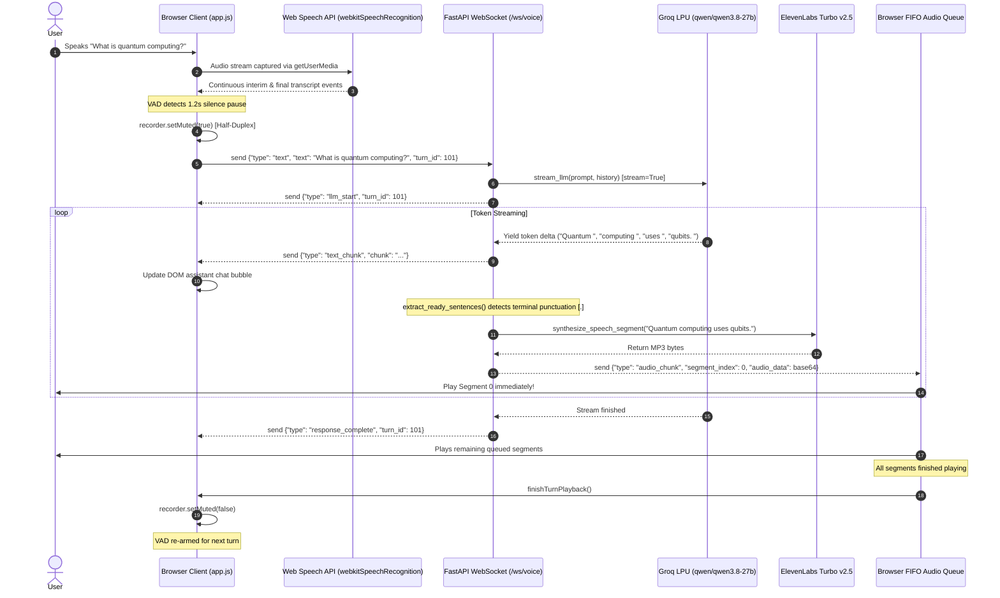

# Low-Level Design (LLD)

**Project Name:** Voice AI Agent Pipeline  
**Version:** 1.1.0  
**Target Audience:** Senior Developers, System Architects, Code Reviewers  
**Document Owner:** Engineering Architecture  
**Last Updated:** October 2026  

---

## 1. Module-Level Breakdown

The system codebase is divided into modular frontend and backend components:

```
c:\Users\aman7\testing AI\
├── app.py                   # FastAPI routing, WebSocket streaming hub, sentence buffer
├── pipeline.py              # Voice pipeline orchestration, Google STT, TTS hierarchy
├── llm_service.py           # Unified LLM provider abstraction, streaming generators
├── run_server.py            # Bootstrap runner with automated Windows port cleanup
└── static/
    ├── app.js               # Frontend application controller, WebSocket client, FIFO queue
    ├── audio-recorder.js    # Web Audio API engine, ScriptProcessorNode, VAD, WAV encoder
    ├── index.html           # Single Page Application HTML5 markup
    └── style.css            # Custom CSS3 styling and glassmorphism design system
```

### 1.1 Backend Modules

#### `app.py`
- **Responsibility:** Application entry point and ASGI routing. Manages HTTP REST endpoints, WebSocket `/ws/voice` connections, regex sentence boundary chunking, background thread delegation for TTS, and static file serving.
- **Key Functions & Routes:**
  - `websocket_voice_endpoint(websocket: WebSocket)`: Primary real-time bidirectional streaming hub.
  - `extract_ready_sentences(buffer: str, is_final: bool)`: Regex sentence and clause boundary parser.
  - `synthesize_speech_segment(text: str, provider: str, keys: dict)`: Worker function synthesizing isolated MP3 chunks.
  - `process_audio(audio, history, keys)`: Multi-part REST handler for fallback audio processing.
  - `process_text(req)`: REST endpoint for text-only pipeline execution.
  - `save_keys(req)`: Configuration persistence handler updating `.env`.
  - `test_llm_provider(req)`: Provider diagnostic and connection verification handler.
- **Dependencies:** `fastapi`, `uvicorn`, `pipeline.VoicePipeline`, `llm_service.UnifiedLLMManager`.

#### `pipeline.py`
- **Responsibility:** High-level coordinator of Speech-to-Text and Text-to-Speech services.
- **Key Classes:**
  - `VoicePipelineError(Exception)`: Standardized pipeline exception capturing execution stage (`STT`, `LLM`, `TTS`).
  - `SpeechToTextService`: Backend STT wrapper around Python's `speech_recognition` library.
  - `ElevenLabsTTSService`: REST API client for ElevenLabs Turbo v2.5 (`eleven_turbo_v2_5`).
  - `LocalNeuralTTSService`: Free neural TTS engine utilizing Microsoft `edge-tts` with Windows SAPI fallback.
  - `VoicePipeline`: Facade coordinating STT, LLM, and TTS execution for both REST and streaming paths.
- **Dependencies:** `speech_recognition`, `requests`, `edge_tts`, `OpenAI`, `llm_service`.

#### `llm_service.py`
- **Responsibility:** Abstracted interface for LLM inference providers.
- **Key Classes & Functions:**
  - `DEFAULT_SYSTEM_PROMPT`: Fallback system instruction defining the voice persona.
  - `format_messages(prompt, history, system_prompt)`: Sliding-window message normalizer (caps at 12 messages).
  - `BaseLLMProvider(ABC)`: Abstract base class defining `generate_response()`, `generate_stream()`, and `verify_connection()`.
  - `GroqProvider`: Groq SDK adapter using `qwen/qwen3.8-27b`.
  - `OpenAIProvider`: OpenAI SDK adapter using `gpt-4o-mini`.
  - `GeminiProvider`: Google GenAI SDK adapter using `gemini-2.0-flash`.
  - `LocalOllamaProvider`: Local Ollama HTTP client using `qwen2.5:1.5b`.
  - `UnifiedLLMManager`: Provider registry, active provider resolver, and dynamic configuration coordinator.
- **Dependencies:** `groq`, `openai`, `google.genai`, `requests`.

#### `run_server.py`
- **Responsibility:** Local server launcher.
- **Key Functions:**
  - `free_port(port: int)`: Detects if socket 8001 is locked on Windows and executes a PowerShell command (`Get-NetTCPConnection ... | Stop-Process`) to terminate orphaned workers before calling `uvicorn.run()`.

---

### 1.2 Frontend Modules

#### `static/audio-recorder.js`
- **Responsibility:** Hardware microphone capture, audio processing, dynamic Voice Activity Detection (VAD), continuous in-browser speech recognition, and 16kHz WAV encoding.
- **Key Class (`AudioRecorder`):**
  - `initSpeechRecognition()`: Configures `webkitSpeechRecognition` with `continuous = true` and `interimResults = true`.
  - `start(liveMode)`: Requests `getUserMedia()`, creates `AudioContext`, and attaches `ScriptProcessorNode(2048, 1, 1)`.
  - `onaudioprocess`: Event handler calculating RMS volume, tracking dynamic noise floor, and detecting silence pauses.
  - `triggerTurn()`: Finalizes speech segment, checks for transcripts, or exports WAV blob.
  - `downsampleBuffer(buffer, sampleRate, outSampleRate)`: Linear decimation from 44.1kHz/48kHz down to 16,000 Hz.
  - `encodeWAV(samples, sampleRate)`: Encodes raw Float32 array into a canonical 44-byte RIFF WAV binary Blob using `DataView`.
  - `setMuted(muted)`: Mutes audio input during assistant playback and aborts speech recognition.

#### `static/app.js`
- **Responsibility:** Main UI controller, WebSocket client, state machine, and audio queue player.
- **Key Functions:**
  - `initVoiceWebSocket()`: Establishes and manages persistent WebSocket connection to `/ws/voice`.
  - `handleWebSocketMessage(data)`: Dispatches incoming socket events (`text_chunk`, `audio_chunk`, `response_complete`).
  - `playNextAudioQueueSegment()`: Pulls next MP3 chunk from `audioQueue` and invokes native `Audio.play()`.
  - `finishTurnPlayback()`: Drains queue, commits turn to `conversationHistory`, un-mutes microphone, and re-arms VAD.
  - `processText(text)`: Dispatches user text over WebSocket (or falls back to `/api/process-text`).
  - `processAudio(wavBlob)`: Fallback handler posting binary WAV blob to `/api/process-audio`.
  - `updateUI()`: Central state machine rendering visual states for the orb, button labels, and status text.

---

## 2. Frontend Implementation Details

### 2.1 State Architecture & Session Machine
In `static/app.js:90-108`, a single centralized state machine governs interaction:

```javascript
const sessionState = {
    mode: 'live_call',        // 'live_call' | 'click_to_talk'
    status: 'idle',           // 'idle' | 'live_listening' | 'recording' | 'processing' | 'speaking' | 'stopping' | 'error'
    turnId: 0,
    abortController: null,
    errorMessage: ''
};
```

### 2.2 Audio Capture & Web Audio Graph
In `static/audio-recorder.js:213-240`, audio hardware is captured and routed:

```javascript
this.mediaStream = await navigator.mediaDevices.getUserMedia({
    audio: {
        channelCount: 1,
        sampleRate: 44100,
        echoCancellation: true,
        noiseSuppression: true,
        autoGainControl: true
    }
});

this.audioContext = new (window.AudioContext || window.webkitAudioContext)();
this.source = this.audioContext.createMediaStreamSource(this.mediaStream);

// Analyser for visualizer canvas
this.analyser = this.audioContext.createAnalyser();
this.analyser.fftSize = 256;
this.source.connect(this.analyser);

// ScriptProcessorNode for sample inspection and VAD
this.processor = this.audioContext.createScriptProcessor(2048, 1, 1);
this.source.connect(this.processor);
this.processor.connect(this.audioContext.destination);
```

### 2.3 Dynamic Voice Activity Detection (VAD)
In `static/audio-recorder.js:243-288`, the processor calculates RMS energy and tracks ambient noise:

```javascript
let sum = 0;
for (let i = 0; i < inputData.length; i++) {
    sum += inputData[i] * inputData[i];
}
const rms = Math.sqrt(sum / inputData.length);

// Continuously calibrate ambient noise floor
if (!this.hasSpokenInTurn) {
    this.noiseFloor = this.noiseFloor * 0.96 + rms * 0.04;
}
const dynamicThreshold = Math.max(this.baseThreshold, this.noiseFloor * 2.2);

if (rms > dynamicThreshold) {
    this.hasSpokenInTurn = true;
    this.lastSpeechTime = Date.now();
    this.audioData.push(channelCopy);
} else if (this.hasSpokenInTurn) {
    this.audioData.push(channelCopy);
    // Silence detected if pause exceeds silenceDurationMs (default 1200ms)
    if (Date.now() - this.lastSpeechTime >= this.silenceDurationMs) {
        this.triggerTurn();
    }
}
```

### 2.4 Sequential FIFO Playback Queue
In `static/app.js:830-910`, incoming audio chunks are queued and chained:

```javascript
// On receipt of audio_chunk
const segment = {
    turnId: data.turn_id,
    index: data.segment_index,
    audioUrl: `data:audio/mp3;base64,${data.audio_data}`,
    text: data.text
};
audioQueue.push(segment);
audioQueue.sort((a, b) => a.index - b.index);

// Immediate playback start on first chunk
if (!isPlayingQueue) {
    playNextAudioQueueSegment();
}

function playNextAudioQueueSegment() {
    if (audioQueue.length === 0) {
        isPlayingQueue = false;
        if (isTurnResponseComplete) finishTurnPlayback();
        return;
    }
    isPlayingQueue = true;
    recorder.setMuted(true); // Half-duplex enforcement
    
    const nextSeg = audioQueue.shift();
    currentAudio = new Audio(nextSeg.audioUrl);
    currentAudio.onended = () => {
        currentAudio = null;
        playNextAudioQueueSegment(); // Chain next segment
    };
    currentAudio.play();
}
```

---

## 3. Backend Implementation Details

### 3.1 Sentence Boundary Chunking Algorithm
The core of the low-latency streaming pipeline is `extract_ready_sentences()` in `app.py:323-366`:

```python
def extract_ready_sentences(buffer: str, is_final: bool = False):
    sentences = []
    if is_final:
        remaining = buffer.strip()
        if remaining:
            parts = re.split(r'(?<=[.!?])\s+', remaining)
            for p in parts:
                if p.strip(): sentences.append(p.strip())
        return sentences, ""

    # Split on complete sentence punctuation
    while True:
        match = re.search(r'([.!?]+(?:\s+|\n+))', buffer)
        if not match: break
        end_pos = match.end()
        candidate = buffer[:end_pos].strip()
        
        # Guard against abbreviations like Dr., Mr., e.g.
        if len(candidate) < 6 and candidate.endswith('.'):
            next_search = re.search(r'([.!?]+(?:\s+|\n+))', buffer[end_pos:])
            if not next_search: break
            end_pos += next_search.end()
            candidate = buffer[:end_pos].strip()

        if candidate: sentences.append(candidate)
        buffer = buffer[end_pos:]

    # Long clause split (comma/semicolon) if buffer exceeds 80 characters
    if len(buffer) > 80:
        clause_match = re.search(r'([,;:]\s+)', buffer)
        if clause_match:
            end_pos = clause_match.end()
            candidate = buffer[:end_pos].strip()
            if candidate and len(candidate) >= 20:
                sentences.append(candidate)
                buffer = buffer[end_pos:]

    return sentences, buffer
```

---

## 4. Speech-to-Text (STT) Implementation

### 4.1 Comparison of STT Paths

| Feature | Primary Path: Web Speech API | Fallback Path: Python SpeechRecognition |
| :--- | :--- | :--- |
| **Execution Host** | Client-Side (Browser Engine) | Server-Side (FastAPI Worker) |
| **Input Format** | Native Browser Audio Stream | 16,000 Hz Mono 16-bit PCM WAV File |
| **Processing Style** | Streaming interim & final events | Batch processing on complete audio buffer |
| **Latency** | <50ms perceived dispatch delay | 800ms – 1,600ms network & recognition roundtrip |
| **Service Endpoint** | Google Chrome Native Speech Service | `recognizer.recognize_google()` Web API |
| **File Reference** | `static/audio-recorder.js:50-130` | `pipeline.py:33-79` |

### 4.2 Status of Faster-Whisper
- **Historical Evaluation:** Evaluated during early local testing.
- **Current Status:** **Removed & Abandoned (Commit `38e4a47`).** It is not present in `requirements.txt` and is not imported in the codebase.

---

## 5. LLM Integration & Unified Manager

### 5.1 Context Sliding Window
In `llm_service.py:31-49`, `format_messages` enforces a strict 12-message sliding window:

```python
def format_messages(prompt: str, conversation_history = None, system_prompt = None):
    sys_prompt = system_prompt or DEFAULT_SYSTEM_PROMPT
    messages = [{"role": "system", "content": sys_prompt}]
    
    # Restrict to last 12 messages (6 conversation turns)
    history = conversation_history or []
    if len(history) > 12:
        history = history[-12:]
        
    for msg in history:
        role = msg.get("role")
        content = msg.get("content")
        if role in {"user", "assistant"} and isinstance(content, str) and content.strip():
            messages.append({"role": role, "content": content.strip()})
            
    messages.append({"role": "user", "content": prompt.strip()})
    return messages
```

### 5.2 Provider Specifications

| Provider | Client Class | Default Model ID | Streaming Call | Error Attribution |
| :--- | :--- | :--- | :--- | :--- |
| **Groq** | `GroqProvider` | `qwen/qwen3.8-27b` | `client.chat.completions.create(stream=True)` | `LLMProviderError("groq")` |
| **OpenAI** | `OpenAIProvider` | `gpt-4o-mini` | `client.chat.completions.create(stream=True)` | `LLMProviderError("openai")` |
| **Gemini** | `GeminiProvider` | `gemini-2.0-flash` | `client.models.generate_content_stream(...)` | `LLMProviderError("gemini")` |
| **Ollama** | `LocalOllamaProvider`| `qwen2.5:1.5b` | Direct REST API stream to `127.0.0.1:11434` | `LLMProviderError("local")` |

---

## 6. Text-to-Speech (TTS) Implementation

### 6.1 Provider Characteristics

| Provider | Class Name | Output Audio Format | Network Requirement | Integration Method |
| :--- | :--- | :--- | :--- | :--- |
| **ElevenLabs** | `ElevenLabsTTSService` | MP3 (`audio/mpeg`) | Requires Internet & API Key | HTTP POST to `https://api.elevenlabs.io/v1/text-to-speech/{voice_id}` |
| **Microsoft Edge TTS** | `LocalNeuralTTSService` | MP3 (`audio/mpeg`) | Requires Internet (No Key) | Async generator via `edge_tts.Communicate.stream()` |
| **Windows SAPI** | `LocalNeuralTTSService` | WAV (`audio/wav`) | 100% Offline (Local OS) | PowerShell .NET `System.Speech.Synthesis.SpeechSynthesizer` |

### 6.2 Synthesis Flow in `app.py:369-380`
```python
def synthesize_speech_segment(text_segment: str, active_p: str, custom_keys: dict) -> bytes:
    audio_bytes = None
    # 1. Try ElevenLabs Turbo if configured
    if active_p != "local" and (custom_keys.get("elevenlabs_api_key") or os.getenv("ELEVENLABS_API_KEY")):
        try:
            audio_bytes = pipeline.cloud_tts.synthesize(text_segment)
        except Exception as e:
            audio_bytes = pipeline.local_tts.synthesize(text_segment)
    # 2. Fall back to Local Neural / Edge TTS
    if audio_bytes is None:
        audio_bytes = pipeline.local_tts.synthesize(text_segment)
    return audio_bytes
```

---

## 7. WebSocket Event Protocol (`/ws/voice`)

The WebSocket interface uses a strongly typed JSON protocol:

| Event Type | Direction | Purpose | Key Payload Properties |
| :--- | :--- | :--- | :--- |
| `config` | Client -> Server | Update session keys/modes | `{"keys": {"llm_provider": "groq", ...}}` |
| `config_ack` | Server -> Client | Acknowledge configuration | `{"type": "config_ack", "status": "ok"}` |
| `ping` / `pong` | Bidirectional | Keep-alive heartbeat | `{"type": "ping"}` / `{"type": "pong", "time": ...}` |
| `text` | Client -> Server | Submit user speech transcript | `{"type": "text", "text": "...", "turn_id": 101, "history": [...]}` |
| `llm_start` | Server -> Client | Signal inference commencement | `{"type": "llm_start", "turn_id": 101, "provider": "groq"}` |
| `text_chunk` | Server -> Client | Deliver incremental token delta | `{"type": "text_chunk", "turn_id": 101, "chunk": "Hello"}` |
| `audio_chunk` | Server -> Client | Deliver synthesized MP3 segment| `{"type": "audio_chunk", "turn_id": 101, "segment_index": 0, "audio_data": "<base64>", "text": "..."}` |
| `response_complete` | Server -> Client | Signal end of turn generation | `{"type": "response_complete", "turn_id": 101, "full_text": "...", "segments_count": 2}` |
| `error` | Server -> Client | Report pipeline failure | `{"type": "error", "turn_id": 101, "stage": "LLM", "message": "..."}` |

---

## 8. REST API Reference

| Method | Endpoint | Description | Request Payload | Response Payload |
| :--- | :--- | :--- | :--- | :--- |
| `GET` | `/api/status` | Safe operational status | None | `{"status": "ready", "active_provider": "groq", "providers": {...}}` |
| `GET` | `/api/health` | Lightweight uptime check | None | `{"status": "healthy", "uptime_seconds": 124.5}` |
| `POST`| `/api/llm/test` | Validate provider credentials | `{"provider": "groq", "model": "qwen/qwen3.8-27b", "api_key": "..."}` | `{"status": "Connected", "connected": true, "message": "..."}` |
| `POST`| `/api/save-keys`| Persist keys to `.env` | `{"llm_provider": "groq", "groq_api_key": "...", ...}` | `{"message": "Configuration updated successfully."}` |
| `POST`| `/api/process-audio` | Fallback audio pipeline | Multipart Form Data: `audio` (WAV Blob), `history` (JSON), `keys` (JSON) | `{"user_text": "...", "assistant_text": "...", "audio_url": "data:audio/mp3;base64,..."}` |
| `POST`| `/api/process-text` | Fallback text pipeline | `{"text": "Hello", "conversation_history": [...], "custom_keys": {...}}` | `{"assistant_text": "...", "audio_url": "data:audio/mp3;base64,..."}` |
| `GET` | `/api/local-models`| List local Ollama models | None | `{"models": ["qwen2.5:1.5b"]}` |
| `GET` | `/api/local-voices`| List Edge TTS voices | None | `[{"id": "en-US-JennyNeural", "name": "Jenny (US Female)"}, ...]` |

---

## 9. Sequence Diagrams

### 9.1 Primary Live-Call WebSocket Pipeline (Path A)



---

### 9.2 Alternative Audio-Upload REST Pipeline (Path B)

```mermaid
sequenceDiagram
    autonumber
    actor User
    participant Browser as Browser Client (app.js)
    participant VAD as AudioRecorder (ScriptProcessorNode)
    participant REST as FastAPI REST (/api/process-audio)
    participant GoogleSTT as SpeechToTextService (Google API)
    participant LLM as UnifiedLLMManager
    participant TTS as ElevenLabs / edge-tts

    User->>Browser: Speaks in Click-to-Talk mode
    Browser->>VAD: Collect raw Float32 PCM samples
    User->>Browser: Clicks "Stop Recording"
    VAD->>VAD: downsampleBuffer(16kHz) -> encodeWAV()
    VAD-->>Browser: Returns 16kHz Mono 16-bit WAV Blob
    
    Browser->>Browser: recorder.setMuted(true)
    Browser->>REST: POST /api/process-audio (FormData: audio.wav, history, keys)
    
    REST->>GoogleSTT: transcribe(audio_bytes) via tempfile.NamedTemporaryFile
    GoogleSTT-->>REST: Return user_text: "Tell me a joke"
    
    REST->>LLM: generate_response(user_text, history)
    LLM-->>REST: Return full assistant_text
    
    REST->>TTS: synthesize(assistant_text)
    TTS-->>REST: Return complete audio bytes (MP3)
    
    REST-->>Browser: 200 OK {"user_text": "...", "assistant_text": "...", "audio_url": "data:audio/mp3;base64,..."}
    
    Browser->>Browser: Render chat bubbles
    Browser->>User: playAudioResponse(audio_url)
    Note over Browser: Audio playback ends
    Browser->>Browser: recorder.setMuted(false)
```

---

## 10. Error Handling & Diagnostics

| Failure Mode | Detection Point | Handling & Recovery Action | User Visibility |
| :--- | :--- | :--- | :--- |
| **Mic Permission Denied** | `audio-recorder.js:213` (`catch`) | Catches `NotAllowedError`; transitions state to `error`. | Toast: "Microphone error: Permission denied" |
| **Empty / Short Audio** | `pipeline.py:48` | Rejects payload if `< 100 bytes`; raises `VoicePipelineError("STT")`. | Toast: "[STT] Audio payload is empty or too short." |
| **STT Unrecognized** | `pipeline.py:65` (`sr.UnknownValueError`) | Raises `VoicePipelineError("STT")`. | Toast: "[STT] Could not understand the audio. Please speak clearly." |
| **WebSocket Closed** | `app.js:792` (`onclose`) | Triggers 3-second auto-reconnection loop; routes requests to REST. | Transparent degradation; connection badge updates |
| **LLM Key Invalid (401)** | `llm_service.py:174` | Catches 401; raises `LLMProviderError("groq", status_code=401)`. | Toast: "[LLM] Invalid API key"; status badge shows "Auth Failed" |
| **LLM Model 404** | `llm_service.py:183` | Catches 404; raises `LLMProviderError(status_code=404)`. | Toast: "[LLM] Model does not exist or you do not have access" |
| **TTS Quota Exhausted** | `pipeline.py:467` | ElevenLabs failure caught; execution falls back to `LocalNeuralTTSService`. | Silent automatic fallback; user hears Microsoft `edge-tts` voice |
| **Windows Port Contention** | `run_server.py:10` | Socket test detects port 8001; kills owning PID via PowerShell. | Console log: "Port 8001 is in use. Freeing port..." |

---

## 11. Conversation State Management

1. **Storage Location:** Client-side in-memory JavaScript array (`conversationHistory` in `static/app.js:113`).
2. **Session Lifetime:** Bound to the browser tab lifecycle. Refreshing the browser resets conversation history.
3. **Database Integration:** **None.** No SQLite, PostgreSQL, Redis, or local storage persistence is used.
4. **Vector Storage / RAG:** **None.** No document chunking, embeddings, or retrieval pipelines exist in the codebase.
